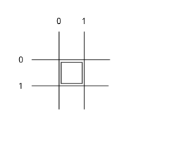
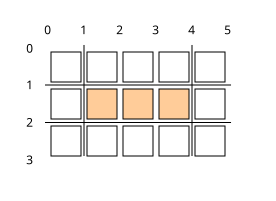
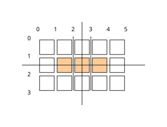

# MulleCG

Part of [MulleUI](https://github.com/MulleUI) — UIKit-shaped modular GUI libraries for mulle-objc.

#### Part of [MulleUI](https://github.com/MulleUI) — UIKit-shaped modular GUI libraries for mulle-objc.

MulleCG is the abstract drawing API of MulleUI. It provides `CGContext`,
`CGPaint`, `CGGradient`, `CGImage`, `CGFont`, `CGFramebuffer` and
`CGLayoutContext` — the classes you draw with. Drawing is delegated to a
pluggable `CGBackend`, so the actual rendering
happens with a concrete backend library.

MulleCG does no animation or layouting, no windowing and does not handle
events. It is the drawing layer only: the window that provides the frame loop
and the concrete backend selection come from
[MulleUIOS](//github.com/MulleUI/MulleUIOS).

> #### Note
>
> Both MulleCA and MulleCG pull in the CGColor typedef. For that reason, if
> you have MulleCA and MulleCG in your project, ensure that MulleCG is before
> MulleCA in your dependency list. MulleGraphics will have the proper order
> but MulleUICore will include MulleCA, so also have MulleGraphics before
> MulleUICore.


| Release Version                                       | Release Notes  | AI Documentation
|-------------------------------------------------------|----------------|---------------
|  [](//github.com/MulleUI/MulleCG/actions) | [RELEASENOTES](RELEASENOTES.md) | [DeepWiki for MulleCG](https://deepwiki.com/MulleUI/MulleCG)


## Documentation & Guides

* [API Summary](asset/dox/api/toc)
* [Coder Guide](asset/howto/coder/mulle-cg)
* [Debugger Guide](asset/howto/debugger/mulle-cg)
* [Verifier Guide](asset/howto/verifier/mulle-cg)

## Usage

Here is a complete draw callback. A window ([MulleUIWindow](//github.com/MulleUI/MulleUIWindow))
creates the layer and the `CGContext` for you and calls your callback once per
frame. You just draw:

``` objc
#import <MulleCG/MulleCG.h>
#import <MulleGraphics/MulleGraphics.h>   // CGGraphicsLayer
#import <mulle-color/mulle-color.h>       // CGColorMake*

static BOOL   draw( CGGraphicsLayer *layer, CGContext *context)
{
   CGPaint   *paint;
   CGRect    rect;

   rect = CGRectMake( 20.0, 20.0, 160.0, 60.0);

   // fill a rounded rectangle with a solid color paint
   paint = [CGPaint paintWithColor:CGColorMakeSkyBlue()];
   CGContextFillRoundedRectWithPaintable( context, rect, 8.0, paint);

   // stroke the same rectangle from the inside
   CGContextStrokeRoundedRectWithPaintable( context, rect, 8.0, 2.0, paint);

   // fill a rectangle with a linear gradient paint
   paint = [CGPaint paintWithStartColor:CGColorMakeLightSkyBlue()
                               endColor:CGColorMakeTransparent()];
   CGContextFillRectWithPaintable( context, CGRectMake( 20.0, 100.0, 160.0, 40.0), paint);

   // draw some text; a length of 0 means "use strlen"
   CGContextFontSize( context, 14.0);
   CGContextTextColor( context, CGColorMakeWhite());
   CGContextText( context, CGPointMake( 30.0, 40.0), "Hello MulleCG", 0);

   return( NO);
}
```

The color constructors come from [mulle-color](//github.com/mulle-gfx/mulle-color),
rectangles and points from [mulle-geometry](//github.com/MulleUI/mulle-geometry);
both are pulled in by MulleCG. See the
[MulleUIWindow demos](//github.com/MulleUI/MulleUIWindow) for the window setup
that feeds `draw:` its `CGContext`.

`demo/main-cglayer-paint.m` is a larger example that renders into offscreen
`CGFramebuffer`s, composites them and swaps layers.

## Build the demo

The `demo/` folder is a [mulle-sde](//github.com/mulle-sde) project:

``` sh
cd demo
mulle-sde craft
```

## Concepts

### Drawing and font management are separate

MulleCG splits rendering into two concerns. Each has its own opaque context
and its own function table, but both live in the same object:

* **Drawing** — `CGContext` owns the draw backend, a `CGBackend` struct made
  of an opaque context plus two embedded vtables: `CGFunctionTable` (paths,
  fill, stroke, transforms, scissor, textures, blending) and
  `CGBackendFunctionTable` (framebuffers). Calls like `CGContextFill`,
  `CGContextRect` and `CGContextBeginFrame` dispatch through them.
* **Font management** — `CGLayoutContext`, the superclass of `CGContext`,
  owns `_fontContext` and a `CGFontFunctionTable` (createFont, findFont,
  fallback fonts, fontSize, textAlign, text, textBox, textMetrics, glyph
  positions, line breaking). All `CGContext*Font*`, `CGContextText*` and
  `CGLayoutContext*` calls dispatch through it.

The two opaque contexts may be the same object — with the nanovg backend
`_fontContext == _cgBackend.context` — or completely different. That is why
`CGContextSave`/`CGContextRestore` push two state stacks, one for drawing and
one for fonts. Text is measured and shaped through the font table and then
rendered through the draw table.

### Backends

MulleCG is backend-agnostic. A concrete backend fills the function tables of
a `CGBackend` and hands you a `CGContext` bound to its graphics context:

* `MulleCGNanovg` — nanovg on OpenGL/OpenGLES
* `MulleCGCairo` — a cairo backend (experimental - not released)
* `MulleCGSkia` — a Skia backend (experimental - not released)

### The object model

* `CGContext` — drawing state and command stream
* `CGPaint` — what you fill and stroke with: solid color, gradient
  (`CGGradient`, linear/radial/box), image (`CGImagePaint`), blended
  (`CGBlendedPaint`)
* `CGImage` — a texture you can draw with and draw into (and itself a
  `CGPaint`)
* `CGFont`, `CGLayoutContext` — text, glyphs and measurement
* `CGFramebuffer` — an offscreen render target


## How to draw pixel perfect rectangles

### The coordinate system

In the end you want to light up pixels on the display and everything else is
just there to help you do that. With that in mind it may come up a surprise,
that with rectangle drawing you can't address individual pixels with a x/y
coordinate (say 10,20). What you are addressing is the space between the pixels.
So the very first pixel, spans the space from 0 to 1 in the horizontal and
vertical directions.



### A rectangle

A rectangle is a `CGRect` from
[mulle-geometry](//github.com/MulleUI/mulle-geometry). In the following we
only consider standardized rects, i.e. with positive width and height.

There are two drawing operations in MulleCG: `fill` and `stroke`, and they
are quite different.

### Fill Operation

If you want to fill three pixels in a horizontal line with a color, you create
a CGRectMake( 1, 1, 3, 1):



AntiAliasing will not come into play here, as we are hitting "pixels" exactly.


### Stroke Operation

You can also achieve this lighting of pixels by drawing a line. The stroke
emanates perpendicular to the line. So to light a single pixel, you
use a strokeWidth of one and stroke right through the center of the pixel.

To cover our three pixels either use a horizontal line going from
CGPointMake( 1.0, 1.5) to CGPointMake( 4.0, 1.5) with a `strokeWidth` of 1.
Or it's a vertical line going from `CGPointMake( 2.5, 1)` to
`CGPointMake( 2.5, 2)`  with a `strokeWidth` of 3.




This unfortunately means that you need to keep the direction of the stroke
in mind, to properly place the stroke center for pixel accurate drawing.
With this in mind, if you can fill, don't stroke.


### Combining stroke and fill

So lets cut right to the chase. Often you want to draw a rectangle with a
border around it (and maybe some text in the middle).
Some layout mechanism has provided you with a CGRect where to draw it.

That rectangle a priori is a fill rectangle. To draw a border without overdraw
inside this rectangle, calculate the appropriate stroke rectangle:
`strokeRect = CGRectMakeStrokeRect( rect, strokeWidth, CGInside)`.

> #### Note
>
> Instead of `CGInside`, you can also use `CGOutside` to draw a border around
> the rectangle or `CGOverlap` which is basically a nop operation and will make
> half the border drawn on the inside and half on the outside.

Now to compute the rectangle to fill this stroked rectangle use
`CGRectMakeFillRect( strokeRect, strokeWidth, CGInside)`.

> #### Note
>
> Instead of `CGInside` you can also use `CGOverlap` to cover the same space.
> `CGOutside` is not really useful here.


## Paints

Everything you fill or stroke with is a `CGPaint`:

| Kind | Class | Example |
|------|-------|---------|
| Solid color | `CGPaint` | `[CGPaint paintWithColor:CGColorMakeSkyBlue()]` |
| Linear gradient | `CGGradient` | `[CGPaint paintWithStartColor:… endColor:…]` |
| Image | `CGImagePaint` | `[[CGImagePaint alloc] initWithImage:image]` |
| Blended | `CGBlendedPaint` | `[paint paintWithPaint:other blend:0.5]` |

The gradient constructors also come in a `rotation:` variant. A paint can be
further transformed: `brightenedPaint:`, `dimmedPaint:`, `saturatedPaint:`,
`desaturatedPaint:`, `transparentPaint:`, `rotatedPaint:`, `reversedPaint`.

Paint a shape with the `CGContext*WithPaintable:` conveniences:

``` objc
CGContextFillRectWithPaintable( context, rect, paint);
CGContextStrokeRectWithPaintable( context, rect, 2.0, paint);
CGContextFillRoundedRectWithPaintable( context, rect, 8.0, paint);
CGContextStrokeRoundedRectWithPaintable( context, rect, 8.0, 2.0, paint);
CGContextFillCircleWithPaintable( context, circle, paint);
CGContextStrokeCircleWithPaintable( context, circle, 2.0, paint);
CGContextFillLineWithPaintable( context, start, end, paint);
CGContextStrokeLineWithPaintable( context, start, end, 2.0, paint);
```

Or set the fill style directly and draw:

``` objc
CGContextSetFillLinearGradient( context, start, end, startColor, endColor);
CGContextSetFillBoxGradient( context, rect, cornerRadius, color, feather, featherColor);
CGContextSetFillRadialGradient( context, circle, outerColor, innerRadius, innerColor);
CGContextFill( context);
```

`CGImage` is itself a `CGPaint`, so you can fill a shape with the contents of
an image — or of a `CGFramebuffer`.


### You are here


## Add

Use [mulle-sde](//github.com/mulle-sde) to add MulleCG to your project:

``` sh
mulle-sde add github:MulleUI/MulleCG
```

To only add the sources of MulleCG with dependency
sources use [clib](https://github.com/clibs/clib):


``` sh
clib install --out src/MulleUI MulleUI/MulleCG
```

Add `-isystem src/MulleUI` to your `CFLAGS` and compile all the sources that were downloaded with your project.


## Install

Use [mulle-sde](//github.com/mulle-sde) to build and install MulleCG and all dependencies:

``` sh
mulle-sde install --prefix /usr/local \
   https://github.com/MulleUI/MulleCG/archive/latest.tar.gz
```

### Legacy Installation

Install the requirements:

| Requirements                                 | Description
|----------------------------------------------|-----------------------
| [MulleUIBase](https://github.com/MulleUI/MulleUIBase)             | Part of [MulleUI](https://github.com/MulleUI) — UIKit-shaped modular GUI libraries for mulle-objc.
| [mulle-objc-list](https://github.com/mulle-objc/mulle-objc-list)             | 📒 Lists mulle-objc runtime information contained in executables.

Download the latest [tar](https://github.com/MulleUI/MulleCG/archive/refs/tags/latest.tar.gz) or [zip](https://github.com/MulleUI/MulleCG/archive/refs/tags/latest.zip) archive and unpack it.

Install **MulleCG** into `/usr/local` with [cmake](https://cmake.org):

``` sh
PREFIX_DIR="/usr/local"
cmake -B build                               \
      -DMULLE_SDK_PATH="${PREFIX_DIR}"       \
      -DCMAKE_INSTALL_PREFIX="${PREFIX_DIR}" \
      -DCMAKE_PREFIX_PATH="${PREFIX_DIR}"    \
      -DCMAKE_BUILD_TYPE=Release &&
cmake --build build --config Release &&
cmake --install build --config Release
```


## Author

[Nat!](https://mulle-kybernetik.com/weblog) for Mulle kybernetiK  


