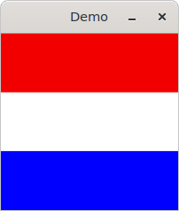
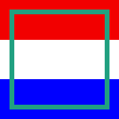
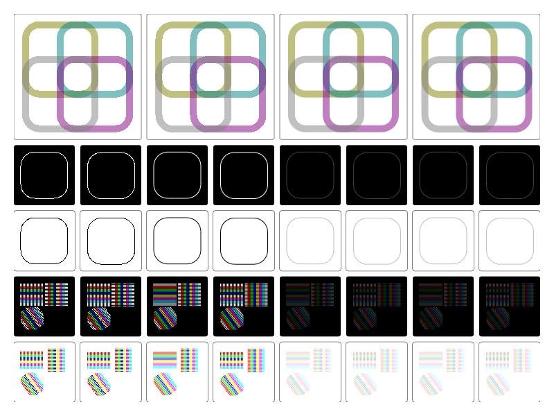
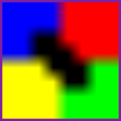
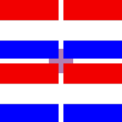
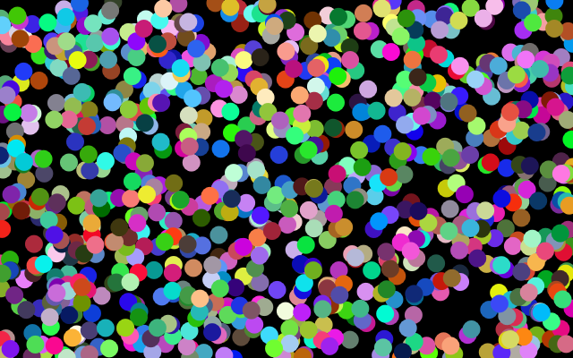
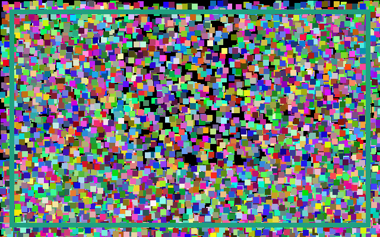
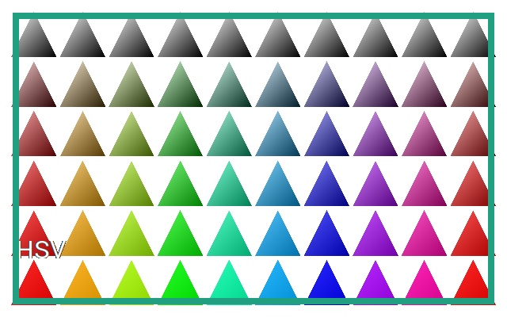
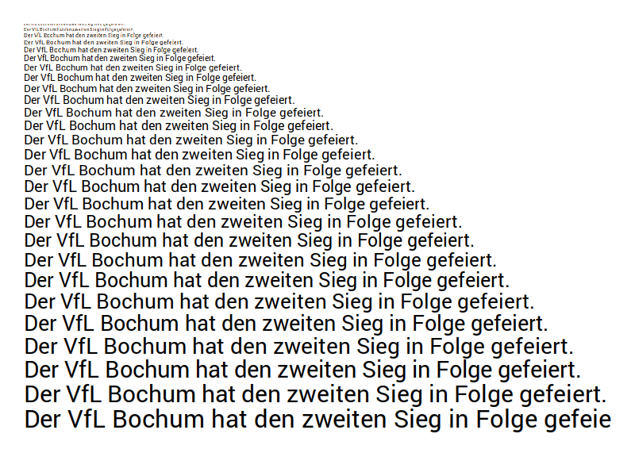

# demos


## MulleCG + MulleGLFW

In the most basic setup **MulleGLFW** is used to get access to a window and
OpenGL/Vulkan/Metal context. This is more cumbersome than using **UIWindow**
though.

### glfw-draw-simple

Just draws three bars of color. Can't get much simpler than that. If this
demo fails, something very basic is going wrong. The window is a basic GLFW
window. We need to subclass GLFWOSWindow actually to tie MulleCG and MulleGLFW
together.



[main-glfw-draw-simple.m](src/main-glfw-draw-simple.m)


### glfw-cglayer

This creates a tiny 64x64 offscreen buffer and fills it with a uniform color.
Then draws a circle into it. The buffer is written to a BMP file.


[main-glfw-cglayer.m](src/main-glfw-cglayer.m)

> The idea of drawing into CGLayers is expanded on in **cglayer**.


## MulleCG + MulleUICore

From here on **UIWindow** is used to demonstrate MulleCG features.

### draw-simple

This is glfw-draw-simple for MulleUICore. It's much, much less code. There is
no need for a window subclass. We don't need to implement
`-[CGContext setActive:]`. We don't have to bother with GLFW windows
hints.



[main-draw-simple.m](src/main-draw-simple.m)


### draw

This demo is actually very resource intensive. MulleCG (and nanovg) don't like
drawing many discrete lines. Notice the performance problems when resizing.
You can pass command line parameter '-r' to use retained (multi-threaded)
code. Notice how the problems vanish. If you use '-m' for running retained on
the main thread, the problems reappear. Using the retained mode on the main
thread can be useful though to detect basic OpenGL/glfw problems.



[main-draw.m](src/main-draw.m)


### cgimage

A very basic textured square. Pretty much the simplest texture example
possible.



[main-cgimage.m](src/main-cgimage.m)


### cglayer

A drawing (the red/white/blue) flag is rendered into an offscreen
framebuffer/texture and then used as an image to draw.



[main-cglayer.m](src/main-cglayer.m)


### particles

This is a small demonstration of drawing particles with nanovg.



[main-particles.m](src/main-particles.m)


### particlelayers

Same as particles, but uses a CALayer for each particle.



[main-particlelayers.m](src/main-particlelayers.m)


### colors

Colors demonstrate the several color models available.



[main-colors.m](src/main-colors.m)


### text

Small text demo with varying size of text.



[main-text.m](src/main-text.m)


## Build

This is a [mulle-sde](https://mulle-sde.github.io/) project.

It comes with its own virtual environment and list of dependencies.
To fetch and build everything say:

```
mulle-sde craft
```
